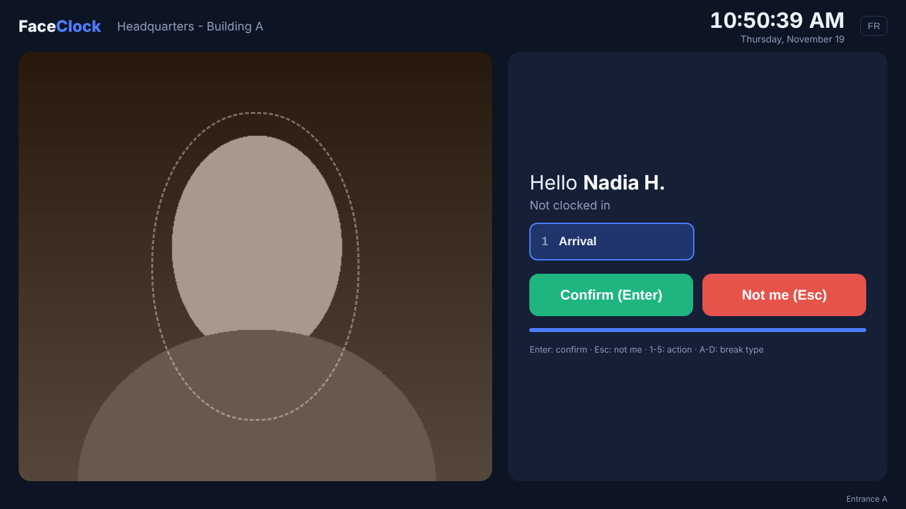
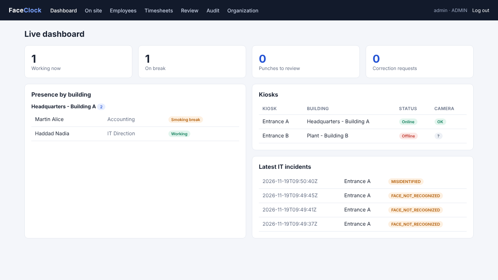
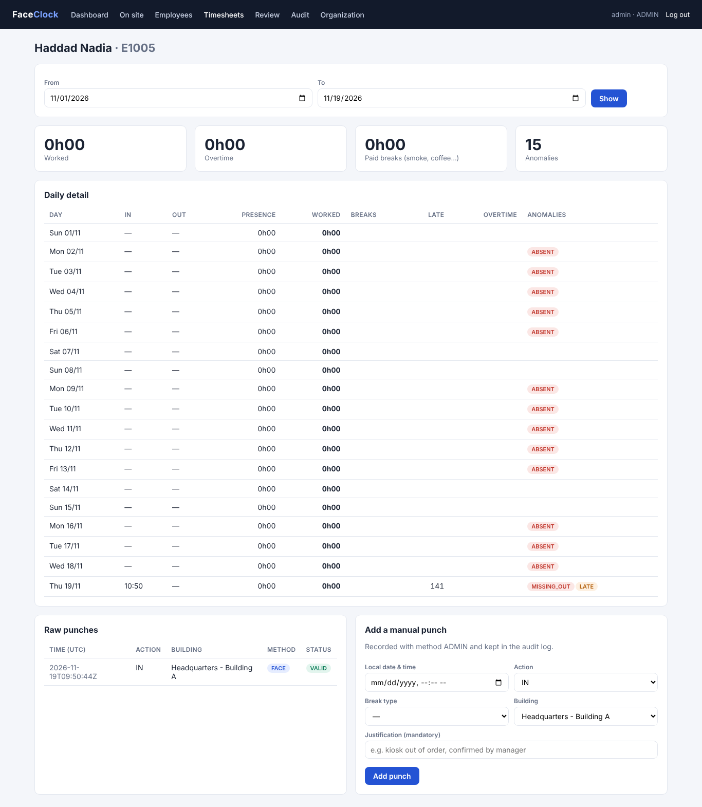
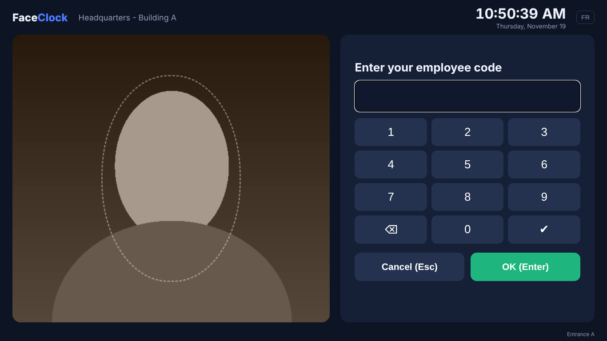
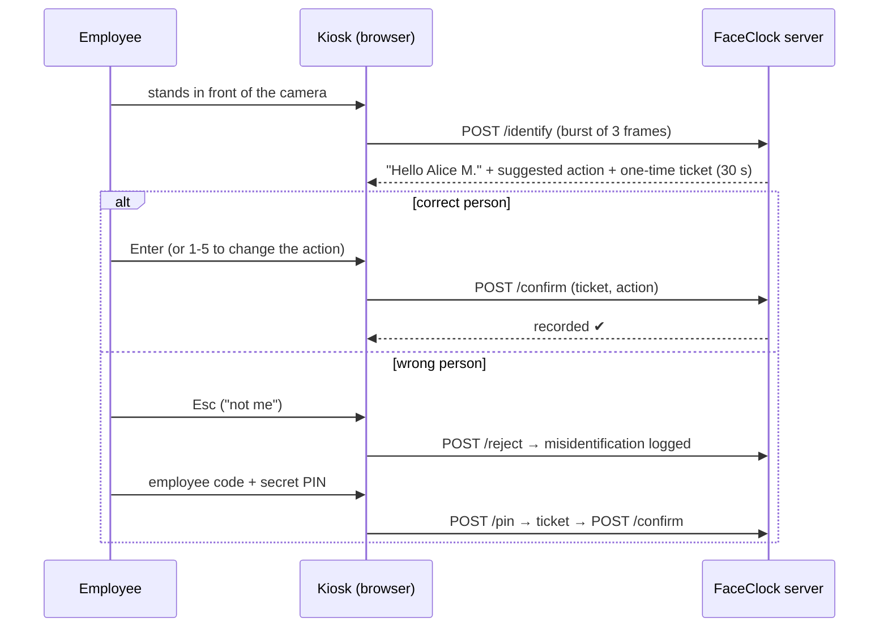

<div align="center">

# FaceClock

### Smart face-recognition time & attendance for multi-site companies

Look at the camera, press **Enter**, you're clocked in.<br>
Several buildings, several directions, breaks, camera failures, server outages: all handled.




</div>

---

## Table of contents

1. [Why FaceClock](#why-faceclock)
2. [Features](#features)
3. [Screenshots](#screenshots)
4. [Windows desktop app](#windows-desktop-app-no-command-line)
5. [Quick start (developers)](#quick-start-developers)
6. [How a punch works](#how-a-punch-works)
7. [Breaks: paid vs unpaid](#breaks-paid-vs-unpaid)
8. [When IT fails](#when-it-fails)
9. [Multi-building & multi-direction](#multi-building--multi-direction)
10. [Architecture](#architecture)
11. [Configuration](#configuration)
12. [Privacy & legal compliance (GDPR)](#privacy--legal-compliance-gdpr)
13. [Security](#security)
14. [Tests](#tests)
15. [Deployment](#deployment)
16. [Roadmap](#roadmap)
17. [Author & licence](#author--licence)

---

## Why FaceClock

Badge readers get lost, shared and forgotten. FaceClock turns any screen with a webcam
(tablet, mini-PC, laptop) into a punch terminal that **recognises the employee in about a
second**, but always lets a human **confirm or correct** the result, and never blocks
anybody when the technology fails.

## Features

| Need | What FaceClock does |
|---|---|
| **Several buildings** | Unlimited sites, each with its own kiosks and timezone. Employees can be restricted to some buildings. Moving between buildings during the day is recorded (`SITE_CHANGE`) so the live presence list is always right. |
| **Several directions** | Department **tree** (Direction → Service → Team). Managers only see their branch; HR and admins see everything. |
| **Smoking / coffee breaks** | Configurable break types. A *paid* break (smoking, coffee) **stays working time** up to a daily allowance; an *unpaid* break (lunch) is deducted. Over-long breaks are flagged. |
| **Confirmation key** | After recognition, the employee presses **Enter** to confirm, or **Esc** ("not me") to correct. Nothing is recorded without confirmation. |
| **Secret PIN fallback** | Each employee has a personal secret PIN (hashed). Used when the camera is broken, the face is not recognised, the proposed name is wrong, or the employee refuses biometrics. |
| **Server / network outage** | The kiosk switches to offline mode, stores punches locally with their real time, and syncs them automatically (idempotent, sent to the review queue). |
| **Forgotten punches** | Forgotten clock-out detection, employee correction requests, manager approval workflow. |
| **Timesheets** | Daily worked time, late arrivals, early departures, overtime, absences, night shifts; CSV export (Excel-ready). |
| **Evacuation roll-call** | Printable real-time list of who is in each building. |
| **Traceability** | Tamper-evident audit log (hash chain), IT incident log per kiosk, method of every punch (FACE / PIN / OFFLINE / ADMIN). |
| **Privacy** | Explicit opt-in consent, only numeric face signatures stored (never photos), employee can withdraw consent and erase their data, retention purge, global *PIN-only* switch. |
| **Bilingual kiosk** | French / English, automatic from the browser language. |

## Screenshots

| Live dashboard | Timesheet detail |
|---|---|
|  |  |

| Recognised: confirm or correct | "Not me" → code + secret PIN |
|---|---|
|  |  |

## Windows desktop app (no command line)

1. Download **`FaceClock-Setup-x.y.z.exe`** from the [latest release](https://github.com/FarhatMohamd/faceclock/releases/latest).
2. Run it (no administrator rights needed). Windows SmartScreen may warn about an unsigned program: click **More info → Run anyway**.
3. Start **FaceClock** from the desktop icon. On the first start a wizard asks for your building name and creates your administrator account.
4. Click **▶ Start terminal** (top bar of the back-office, or in the FaceClock window): the camera starts and employees are recognised. Nothing to copy: the terminal is registered automatically and remembered on this computer. With several buildings, FaceClock asks once which one. The ⚙ button on the terminal goes back to the back-office.
5. The FaceClock window also gives one-click access to:
   * **Punch terminal (camera)**: same as Start terminal; allow the camera once.
   * **Back-office**: employees, face enrolment, timesheets, review queue.
   * **Employee portal** and the **data folder** (`%APPDATA%\FaceClock`: database, settings, log).

Face models are included, nothing is downloaded. FaceClock runs only on this computer (`127.0.0.1`); uninstalling keeps your data.
A portable version (`FaceClock-Portable-x.y.z.zip`, unzip and run `FaceClock.exe`) is attached to each release as well.

To build it yourself on Windows: `pip install -r requirements.txt pyinstaller`, `python scripts/download_models.py`, `pyinstaller packaging/faceclock.spec`, then compile `packaging/installer.iss` with Inno Setup 6.

## Quick start (developers)

```bash
git clone https://github.com/FarhatMohamd/faceclock.git
cd faceclock
python -m venv .venv && source .venv/bin/activate      # Windows: .venv\Scripts\activate
pip install -r requirements.txt

python scripts/download_models.py                      # YuNet + SFace ONNX models (~40 MB)

export FACECLOCK_SECRET_KEY="$(python -c 'import secrets; print(secrets.token_hex(32))')"
flask --app faceclock seed-demo                        # demo company, prints logins / PINs / kiosk URLs
flask --app faceclock run
```

Then open:

* **Back-office**: <http://localhost:5000/admin> (credentials printed by `seed-demo`)
* **Kiosk**: the `/kiosk?token=…` URL printed by `seed-demo` (the token is then kept by the browser)
* **Employee portal**: <http://localhost:5000/me> (employee code + PIN)

Enrol a face: *Employees → employee → tick consent → Save → Start camera → Capture & enrol*.

> Browsers only give camera access on `https://` or `localhost`. In production, serve FaceClock behind HTTPS.

Without the model files the application still starts: kiosks automatically run in **code + PIN** mode.

## How a punch works



**Clock state machine**

```
OFF ──IN──▶ WORKING ──BREAK_START──▶ ON_BREAK
 ▲            │  ▲                      │
 └────OUT─────┘  └───────BREAK_END──────┘
              └──SITE_CHANGE (another building, time unaffected)
```

* The kiosk **pre-selects the most likely action** (arrival in the morning, end of break when on break…).
* Leaving while on break closes the break automatically.
* The same punch repeated within 60 s is ignored (double detection).
* A shift left open more than 16 h is considered forgotten and flagged.

**Kiosk keyboard shortcuts**

| Key | Action |
|---|---|
| `Enter` | Confirm the proposed action |
| `Esc` | "Not me" → correction with code + PIN |
| `1`…`5` | Choose another action |
| `A`…`D` | Break type (smoking, coffee, lunch, personal) |
| `P` | Use code + PIN directly |

## Breaks: paid vs unpaid

Default policy (editable in *Organization → Break policy*):

| Type | Paid | Daily allowance | Max per break |
|---|---|---|---|
| Smoking | ✔ | 20 min | 10 min |
| Coffee | ✔ | 20 min | 15 min |
| Lunch | ✘ | — | 90 min |
| Personal | ✘ | — | — |

Example: 09:00 in → 8 min smoking break → 1 h lunch → 17:00 out
⇒ presence 8 h 00, **worked 7 h 00** (the smoking break is counted as work, lunch is not).
Beyond the allowance, the extra minutes are deducted and the day is flagged `BREAK_ALLOWANCE_EXCEEDED`.

## When IT fails

| Situation | Behaviour |
|---|---|
| Camera missing / broken / unplugged | Kiosk shows the PIN pad, reports `CAMERA_FAILURE`, the dashboard shows the kiosk camera in red. |
| Face not recognised (3 attempts) | PIN pad opens automatically. |
| Wrong person proposed | "Not me" → PIN; the event is logged to tune the recognition threshold. |
| Models missing / engine crash | Server starts in PIN-only mode, nothing is lost. |
| Server or network down | Offline banner, punches queued in the kiosk with their real timestamp, synced automatically; PIN verified at sync; punches sent to the review queue. |
| Forgotten punch | Employee requests a correction in the portal; the manager approves; everything is audited. |
| Manual fix by HR | Manual punch with mandatory justification (method `ADMIN`). |

## Multi-building & multi-direction

```
Company
├── Headquarters - Building A          ← kiosks "Entrance A", "Lobby"
├── Plant - Building B                 ← kiosk  "Entrance B"
└── Departments (tree)
    ├── Finance Direction
    │   └── Accounting
    ├── Operations Direction           ← manager "ops.manager" sees Operations + Logistics + Maintenance
    │   ├── Logistics
    │   └── Maintenance
    └── IT Direction
```

* Each kiosk belongs to one building; the recognition only considers employees allowed in that building (faster and fewer errors).
* Each building has its own timezone (subsidiaries abroad).
* Roles: `ADMIN` (everything), `HR` (all employees, no settings), `MANAGER` (own department and sub-departments).

## Architecture

```
faceclock/
├── faceclock/
│   ├── __init__.py          # application factory
│   ├── config.py            # settings (env variables FACECLOCK_*)
│   ├── schema.sql           # SQLite schema
│   ├── db.py                # connection & UTC time helpers
│   ├── security.py          # PIN hashing & lockout, kiosk tokens, roles, CSRF
│   ├── cli.py               # flask commands (seed-demo, create-admin, purge, verify-audit…)
│   ├── face/
│   │   ├── engine.py        # pluggable engine: OpenCV YuNet detector + SFace recognizer
│   │   ├── matcher.py       # 1:N gallery, threshold + ambiguity margin
│   │   └── liveness.py      # basic anti-photo / anti-replay check
│   ├── services/
│   │   ├── punches.py       # clock state machine & rules
│   │   ├── timesheet.py     # worked time, breaks, anomalies, presence
│   │   ├── recognition.py   # enrolment & identification
│   │   └── audit.py         # tamper-evident audit log
│   ├── api/kiosk.py         # JSON API for kiosks
│   ├── views/               # back-office, employee portal, kiosk page
│   ├── templates/  static/  # HTML / CSS / JS (no front-end build step)
├── scripts/download_models.py
├── tests/                   # 40 pytest tests (fake face engine, no model needed)
├── Dockerfile  docker-compose.yml
```

**Recognition pipeline**: YuNet detects the face and 5 landmarks → SFace aligns and computes a
128-D signature → cosine similarity against the gallery. A match is accepted only if it is above the
threshold **and** clearly ahead of the second-best employee (look-alikes, twins). Everything runs on CPU.

The engine is an interface (`detect` + `embed`): another backend (dlib, InsightFace, a cloud API…)
can be plugged with `register_engine()` without touching the rest of the code.

## Configuration

Environment variables (see [`.env.example`](.env.example)):

| Variable | Default | Description |
|---|---|---|
| `FACECLOCK_SECRET_KEY` | random | **Required in production** (sessions, kiosk tickets) |
| `FACECLOCK_DATABASE` | `instance/faceclock.db` | SQLite file |
| `FACECLOCK_BIOMETRICS_ENABLED` | `true` | `false` = PIN-only time clock |
| `FACECLOCK_MATCH_THRESHOLD` | `0.42` | Minimum cosine similarity |
| `FACECLOCK_MATCH_MARGIN` | `0.06` | Required lead over the 2nd candidate |
| `FACECLOCK_LIVENESS_ENABLED` | `true` | Multi-frame anti-photo check |
| `FACECLOCK_MIN_FACE_SIZE` | `80` | Minimum face size in pixels |
| `FACECLOCK_SECURE_COOKIES` | `false` | Set `true` behind HTTPS |
| `FACECLOCK_PUNCH_RETENTION_DAYS` | `1825` | Retention used by `flask purge` |

Other rules (debounce, ticket lifetime, PIN lockout, offline limits) are in `faceclock/config.py`.

**CLI commands**

```bash
flask --app faceclock init-db
flask --app faceclock create-admin alice --role HR
flask --app faceclock create-admin bob --role MANAGER --department OPS
flask --app faceclock create-kiosk "Entrance C" "Plant - Building B"
flask --app faceclock verify-audit
flask --app faceclock purge --dry-run
```

## Privacy & legal compliance (GDPR)

Face templates are **biometric data** (GDPR art. 9). Rules differ between countries and
are strict for time tracking. In **France**, the CNIL considers biometric time tracking
**disproportionate in principle** when a badge or a code is enough. Before any deployment, check
your local regulation, run a DPIA, and consult employee representatives.

FaceClock is designed so that compliance is possible:

* **PIN-only mode** with a single switch (`FACECLOCK_BIOMETRICS_ENABLED=false`): the whole product
  (multi-site, breaks, timesheets, offline mode…) works without any biometric processing.
* **Opt-in per employee**: without recorded consent, no face template can be created and the
  employee is never matched; code + PIN is always available as an equivalent alternative.
* **No photos**: only numeric signatures are stored; enrolment pictures are discarded immediately.
* **Right to erasure**: employees withdraw consent from their portal, templates are deleted at once.
* **Retention**: `flask purge` removes old punches, old incidents and templates of departed staff.
* **Minimisation on screen**: the kiosk only shows first name + initial.

## Security

* PINs and passwords hashed (Werkzeug scrypt/pbkdf2), PIN lockout after 5 failures (15 min),
  identical error for unknown code and wrong PIN.
* Kiosks authenticated by a secret token (only its SHA-256 is stored).
* Recognition results are signed, **single-use tickets** valid 30 s and bound to the kiosk.
* CSRF protection on every back-office form, security headers, HTTP-only cookies.
* Role-based access with department scoping.
* Audit log chained with SHA-256: `flask verify-audit` detects any modification or deletion.

## Tests

```bash
pip install -r requirements-dev.txt
pytest
```

The suite uses a deterministic fake face engine, so it runs anywhere in a few seconds
(face punch, confirmation, "not me" + PIN, lockout, ticket replay, multi-site rules, offline sync,
paid / unpaid breaks, allowances, late / early / overtime, missing clock-out, night shifts,
manager scope, correction workflow, consent withdrawal, audit tampering, liveness).

## Deployment

```bash
cp .env.example .env          # set FACECLOCK_SECRET_KEY
docker compose up -d --build
docker compose exec faceclock flask --app faceclock seed-demo     # or create-admin
```

Put a reverse proxy with HTTPS (Caddy, Nginx, Traefik) in front of port 8000.
Kiosks: any device with Chrome / Edge / Firefox in full-screen (kiosk) mode.

## Roadmap

* Dedicated anti-spoofing model (depth / texture) for high-security sites
* PostgreSQL backend for very large fleets
* Payroll exports (Silae, Sage, ADP…)
* E-mail / Teams notifications for anomalies
* QR-code or NFC badge as an additional non-biometric method

## Author & licence

**FARHAT Mohamad** — design and development.

Released under the [MIT licence](LICENSE).
